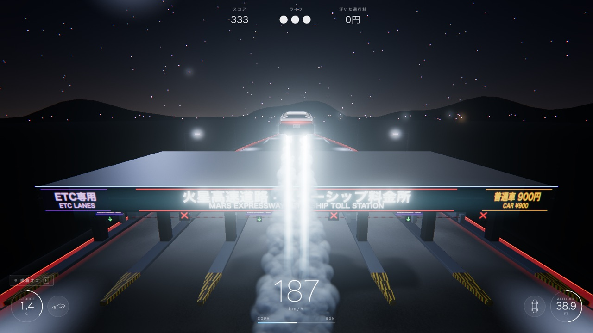
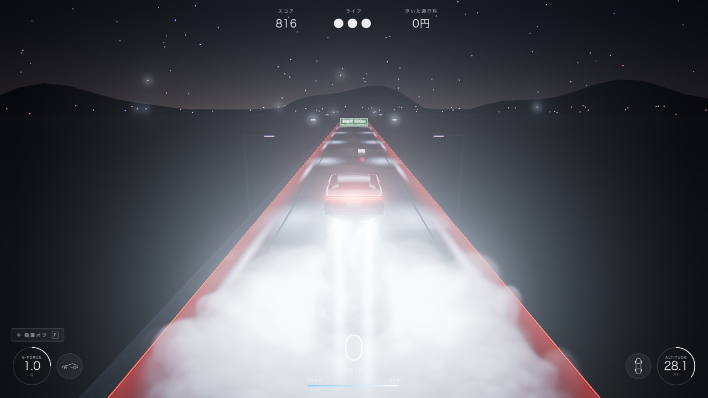
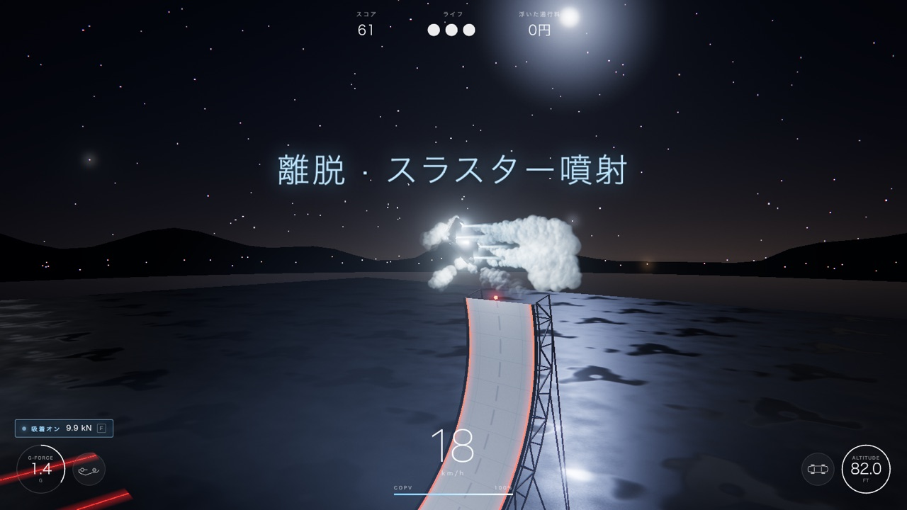

<p align="center">🌐 <a href="README.md">English</a> · <a href="README.zh-CN.md">简体中文</a> · <b>日本語</b></p>

# 料金所ジャンプ · RDSTR Toll Jump

**新型 Tesla Roadster で、SpaceX のコールドガス・スラスターを噴かして料金所を飛び越える。** ブラウザですぐ遊べる 3D ドライビングゲームです。

<p align="center">
  <a href="https://ryoshumei.github.io/toll-jump/?lang=ja"><b>▶ 今すぐプレイ</b></a> · <a href="https://toll-jump.vercel.app/?lang=ja">ミラー</a>
</p>



> 非公式のファン作品です。Tesla・SpaceX とは関係なく、両社の公認も受けていません。

## 遊び方

- **飛ぶ**：スペースキーを押し続けると、車体下の 4 つのノズルからガスを下向きに噴射して浮き上がります。噴射中に S キーを押し続けると、空中でその場に止まってホバリングします。Shift キーでリアスラスターを噴かして加速します。
- **通行料を浮かせる**：料金所の屋根の上を飛び越えるか、開閉バーをジャンプで越えれば、通行料はタダ（「飛べば高速代はタダ」というネットのネタ）。ETC レーンはバーが自動で開くので、そのまま通れば普通に料金がかかります。一般レーンのバーを強行突破すると罰金です。
- **スタントアリーナ**：高速道路の出口を降りると、ほかの車が走っていないスタント専用の会場があります。F キーで車体下の吸着ファンをオンにして、垂直を越えて反り返るほどカーブした壁を駆け上がります。頂上から逆さまのまま飛び出すと、スラスターが車体を立て直して向きを変え、進入時とは逆向きに着地します。
- **スコア**：走行距離、滞空時間、バレルロール、ニアミス、通行料の踏み倒し、スタントで加点。強行突破は減点です。ライフは 3 つで、ハイスコアは保存されます。

<p align="center">
  
  
</p>

## 操作

| キー | 操作 |
| --- | --- |
| W / ↑ | アクセル |
| S / ↓ | ブレーキ（噴射中に長押しするとその場でホバリング） |
| A D / ← → | ハンドル |
| スペース（長押し） | スラスター噴射：上昇・ホバリング（壁面では離脱）。ガス残量は画面下の COPV ゲージで確認でき、着地すると回復します |
| Shift | リアスラスターで加速（最高 約380 km/h） |
| F | 吸着オン / オフ（車体下のファンで路面や壁に吸い付く） |
| Q / E | 空中でバレルロール（着地前に回り切ること） |
| C | カメラ切替：チェイス / サイド / ドローン |
| L | 言語切替：中文 → English → 日本語 |
| Esc · M · R | ポーズ · ミュート · リスタート |

**Enter** キーまたはクリックでスタート。スマートフォンやタブレットでは車が自動で前進し、ハンドル操作・ブレーキ・噴射・加速・バレルロールと、吸着のオン / オフは画面上のボタンで行います。アリーナの壁では、吸着オンのまま「減速」を長押しするとその場で止まり、離すとまた登り始めます。

## 言語

中国語・英語・日本語に対応しています。

- 初めて開いたときは、ブラウザの言語設定に合わせて表示されます。
- **L** キー、またはスタート画面右上の **中文 · EN · 日本語** ボタンで切り替えられます。選んだ言語は次回も引き継がれます。
- 言語を指定して開くこともできます：[日本語](https://ryoshumei.github.io/toll-jump/?lang=ja) · [English](https://ryoshumei.github.io/toll-jump/?lang=en) · [简体中文](https://ryoshumei.github.io/toll-jump/?lang=zh)
- 道路標識はふだん中国語と英語の 2 段表記ですが、日本語を選ぶと日本語と英語になり、料金も円で表示されます（最初の料金所は普通車 900 円）。

## ローカルで動かす

Node.js 22.12 以上（または 20.19 以上）が必要です。

```bash
npm install
npm run dev        # 開発サーバー http://localhost:5173
npm run build      # 型チェック + 本番ビルド（dist/ に出力）
npm run preview    # ビルドを確認 http://localhost:4173
npm test           # ユニットテスト（vitest）
```

## URL パラメーター

| パラメーター | 内容 |
| --- | --- |
| `?lang=zh\|en\|ja` | 表示言語（保存され、次回もこの言語で開きます） |
| `?quality=low\|high` | 画質プリセット（ピクセル比の上限、シャドウマップ、パーティクル数、MSAA） |
| `?debug` | 左上に fps、フレーム時間、ドローコール数、ポリゴン数を表示 |
| `?car=glb\|procedural` | Blender で作った車か、コードで生成する車かを指定（既定：Blender の車。読み込めない場合はコード生成の車） |
| `?autostart` | スタート画面を飛ばす |
| `?touch` | PC でもタッチ操作モードにする（ボタンを表示し、車は自動で前進） |

<details>
<summary><b>しくみ</b></summary>

- **構成**：Vite + TypeScript（strict）+ three.js。物理エンジンは使わず、アーケード風の物理演算はすべて自前で実装しています（`src/sim/`：three.js に依存しない純粋なロジックで、ユニットテスト付き）。ワールド、テクスチャ、サウンドはすべてコードで生成しています。
- **車のモデル**：Python スクリプト（`tools/blender/build_roadster.py`）で Blender 上にモデリングし、`public/models/roadster.glb` に書き出しています。ファイルがない、または読み込めない場合は、コードで生成する車に自動で切り替わります。ノード名の決まりは `docs/CAR_MODEL.md` にあるので、それに沿った `roadster.glb` を置けば差し替えられます。
- **スラスターと煙**：加算合成のコーンを重ねたガスの噴流、ノズルのグレア、車体下のライト。煙は 1 回のインスタンス描画（深度ソートした約 2,500 パーティクル）で、路面に当たると大きな雲になって広がります。地面が近づくと着地用の噴射が自動で入ります。
- **描画**：バネで追従するチェイスカメラ、HDR のポストエフェクト（ブルーム、周辺減光、フィルムグレイン、速度に応じて強まる色収差、ACES トーンマッピング）、負荷に応じて変わるピクセル比。シェーダーは読み込み画面ですべてコンパイルするので、プレイ中にコンパイルでカクつくことはありません。
- **サウンド**：WebAudio でリアルタイムに合成（モーター音、スラスターの轟音、風切り音、吸着ファン、衝突音、ETC の「ピッ」）。
- **テキスト**：UI の文言はすべて `src/ui/i18n.ts` の辞書 1 つにまとめ、どの言語にも全キーがそろっているかをテストで確かめています。標識は canvas テクスチャで、言語を切り替えるとすぐに描き直します。

</details>

<details>
<summary><b>パフォーマンス</b></summary>

Playwright で Chromium headless shell を動かし、実際の GPU で計測（`--use-angle=metal`、Apple M4、1600×900、本番ビルド、`tools/perf.mjs`）：

| 場面 | ピクセル比 | 平均フレーム時間 | p95 | fps |
| --- | --- | --- | --- | --- |
| 他車の間を縫って走行（150〜320 km/h） | 1.0 | 16.67 ms | 16.8 ms | 60 |
| 濃い煙の中でホバリング（約 1,100 パーティクル） | 1.0 | 16.67 ms | 16.8 ms | 60 |
| 走行 | 1.5 | 16.67 ms | 16.8 ms | 60 |

60 Hz の上限を外し、ほかに負荷のない状態で測ると、平均フレーム時間は走行中 2.95 ms、濃い煙の中でのホバリング中 7.26 ms でした。バックグラウンドで Blender を動かしている状態では、ピクセル比が 1.5 から 1.25 に自動で下がり、60 fps を保ちました。

なめらかに動く理由：`renderer.setAnimationLoop`、物理ステップの上限（dt ≤ 1/30）、フレームループ内でメモリを確保しないこと、インスタンス化・結合したジオメトリ（ドローコール約 150）、シェーダーの事前コンパイル、そしてリアルタイムの影を落とす光源を、車を追う月明かり 1 つに絞っていること。

</details>

<details>
<summary><b>ファイル構成</b></summary>

```text
src/main.ts     ゲームループ、状態遷移、シーン切替（高速道路 / アリーナ）、デバッグ用フック
src/config.ts   調整用の数値をすべて集約
src/sim/        ゲームロジック本体（ユニットテスト付き）：車両、吸着、壁、料金所、衝突、スコア、コース
src/render/     車、スラスター、煙、道路、料金所、出口ランプ、アリーナ、交通、ポストエフェクト、カメラ
src/ui/         HUD、各画面、サウンド、入力、多言語
tools/          Playwright スクリプト（スクリーンショット、パフォーマンス、スモークテスト）と Blender の車モデル用スクリプト
docs/           SPEC.md（ゲーム仕様）、CAR_MODEL.md（GLB の仕様）、img/（README 用スクリーンショット）
```

</details>

<details>
<summary><b>テスト</b></summary>

- `npm test` でユニットテストを実行：推力・重力・ガス残量、ホバリング時のブレーキ、バレルロール、吸着、アリーナの壁（張り付き、落下、頂上からの飛び出し、反転、逆向きの着地）、料金所でのすべての判定、衝突とニアミス、スコア、コースの配置、交通ルール、入力（リスタートをまたいで押されたままのキー、タッチ操作時のアクセル・ブレーキ）、多言語の辞書。
- `node tools/smoke-test.mjs`（先に `npm run preview`）は、主な場面をそれぞれデバッグ機能で用意したうえで、実際のキー入力でプレイします：走行、スラスター、ETC レーン通過、料金所の飛び越え、言語切替、壁の上端からのスタント、本線への復帰。
- `node tools/restart-check.mjs` は、キーを押したまま・ポーズ画面から・アリーナの壁の上で、それぞれリスタートし、毎回まっさらな状態から始まるかを確かめます。
- `npm run shots`（先に `npm run preview`）でスクリーンショット一式を `shots/` に書き出します（リポジトリには含めません）。`SHOT_LANG=en` や `ja` を付けると、その言語で撮影します。

</details>
