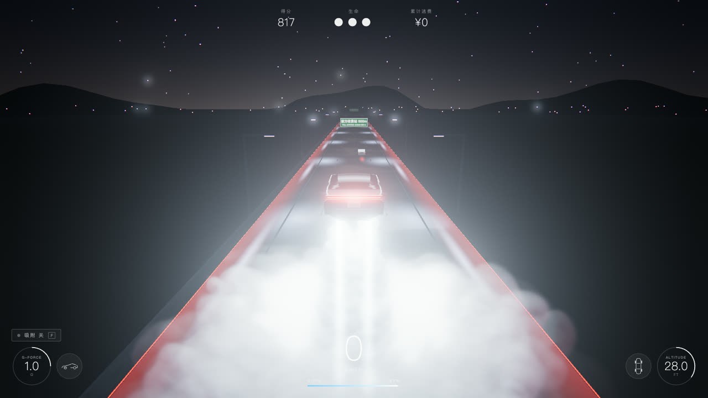
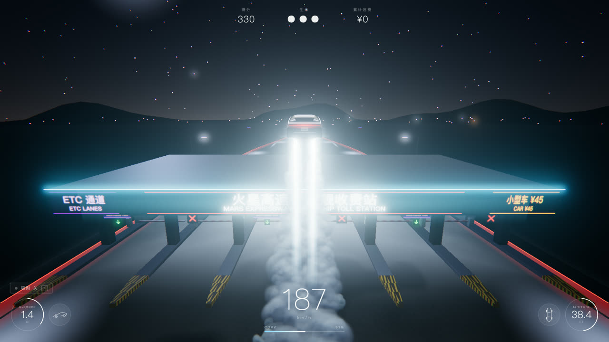
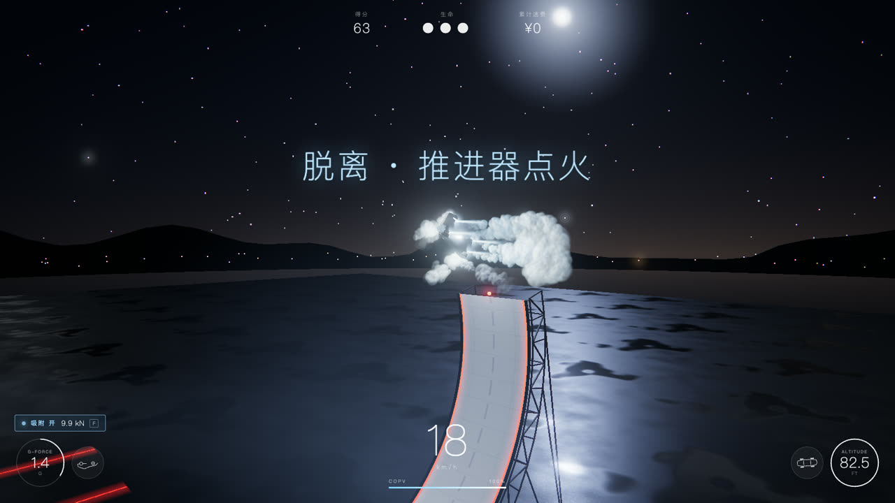

# 飞跃收费站 · RDSTR Toll Jump

**在线试玩 / Play**：<https://ryoshumei.github.io/toll-jump/>（中国大陆一般可以打开）· <https://toll-jump.vercel.app>（海外访问更快 / faster outside mainland China）



> 非官方粉丝作品，与 Tesla、SpaceX 无关。/ Unofficial fan project, not affiliated with Tesla or SpaceX.

一个 3D 网页驾驶游戏：在夜间高速上驾驶新款 Tesla Roadster，用「SpaceX 冷气推进套件」悬停、飞越车流和收费站（逃费梗）；驶入**特技场匝道**，在独立的特技场里开上弧形墙、从墙顶翻身掉头、悬停降落。界面支持**中文 / English / 日本語**（按 L 切换）。English and 日本語 sections: see below.

技术栈：Vite + TypeScript（strict）+ three.js（WebGLRenderer）。没有物理引擎，街机物理全部自己写；世界、贴图、音频全部程序生成。

## 运行

```bash
npm install
npm run dev        # 开发服务器 http://localhost:5173
npm run build      # tsc 类型检查 + vite 构建（输出 dist/）
npm run preview    # 预览构建结果 http://localhost:4173
npm test           # vitest：src/sim 与 src/ui/i18n 的单元测试
```

按 **Enter** 或点击画面开始。

## 操作

| 按键 | 动作 |
| --- | --- |
| W / ↑ | 加速 |
| S / ↓ | 刹车；**空中开着推进器时按住 = 定点悬停**（刹停前进速度并保持高度） |
| A D / ← → | 转向（平滑，响应随速度变化；开吸附时抓地更好） |
| 空格（按住） | 冷气推进：升空、悬停，消耗 COPV 气瓶，落地后回充；**在特技场的墙上 = 脱离** |
| Shift | **后向喷气加速**：两道长长的青白色水平羽流 + 拖尾烟雾，路面被照亮，FOV 冲击与轻微震屏；路上和空中都有强劲推力，最高约 380 km/h；消耗气瓶 |
| F | **吸附（车自带的风扇系统）开 / 关**，HUD 的 G-FORCE 旁始终显示状态和下压力 |
| Q / E | 空中桶滚（约 0.8 秒转完，**转到一半落地算撞车**） |
| C | 镜头：追尾 / 侧拍 / 无人机 |
| L | 切换语言：中文 / English / 日本語（也可点开始画面右上角的按钮） |
| Esc / M / R | 暂停 / 静音 / 重新开始（一切回到开局：35 km/h、3 条命、¥0；重新开始时还按着的 W / Shift 要松开再按才生效） |

手机上会显示触屏按钮（转向、推进、加速、桶滚）。

## 玩法与特性

- **夜间高速**：4 车道 + 路肩，湿沥青，护栏上的红色 LED 灯带，冷白路灯（灯光用加性「光池」贴花，不是真实光源），星空、山影、城市微光。道路是循环使用的区块池，运行时不创建/销毁对象。
- **冷气推进（核心效果）**：4 个朝下喷口 + 2 个后向喷口 + 侧向 RCS。嵌套加性锥体（白色内核 + 青白外焰，滚动噪声与闪烁）、喷口眩光、车底一盏冷白点光源；烟雾是**一次实例化绘制**（约 2500 粒子，每帧深度排序）：羽流打到地面后翻滚扩散成大团云，留在世界空间里拖在车后；高空时烟雾向下拖尾；靠近红色灯带的低处烟雾带粉红色。快速下落接近地面时**落地缓冲**自动点火（不耗气），形成巨大的落地云团。
- **吸附（吸附系统，F 键）**：车底风扇，**是车的系统，不是墙的**。路上：抓地更好（高速转向更利落、更少侧滑）、车身下沉几厘米、涡轮啸叫、侧裙处吸入小颗粒；墙上：让车能慢速爬、停住、倒挂在过垂直段；空中：无效（没有表面）。**不开吸附时，车只在速度够快时才贴在墙上（向心力要胜过重力的拉扯）；速度一慢就会掉下来，HUD 提示「吸附未开启 / SUCTION OFF」。**
- **特技场（v1 的墙）**：高速上每约 3 公里有一个右侧**特技场匝道**，1 km 和 500 m 处有中英双语指示牌，匝道尽头的发光门通过淡入淡出（标题卡「特技场 STUNT ARENA」）进入一个**独立、没有车流的场景**：深色开阔场地、地面长条红色 LED 线、几座对准墙的冷光探照灯塔和薄雾。场地中央是约 7 米宽的弧形白色混凝土墙（虚线中线、两侧红色 LED、背后钢桁架），从地面起弯、越过垂直再多 15°，顶部约 20 米高并向进场方向后仰。
  - 开吸附后沿墙开上去：W 上爬、S 下行、不踩油门原地吸住不动（包括过垂直的倒挂段）、A/D 左右移动；**空格在任意高度脱离**，开出墙顶也会自动离墙。
  - 离墙瞬间车是**倒着、车头朝上偏后**；推进器和 RCS 自动用约 1.2 秒把车**翻正并掉头**，各方向喷出羽流和气团；随后车在朝下的羽流上悬停，最后落地缓冲 + 巨大云团，**车头朝向与来时相反**，再原路开出场地大门，淡入回到高速的匝道汇入口（朝向恢复为高速方向，速度保持）。完成一次特技 +2500 分。
- **收费站（逃费梗）**：第一个在约 800 米，之后每 2 公里一个，价格逐站微涨，并累计「累计逃费」。道路在进站前渐变加宽到 **6 条宽车道**（每个开口 ≥ 5.5 米，岛宽约 1.2 米，碰撞盒比视觉略小，可以高速通过）。约一半车道是 **ETC 车道**（紫色 ETC 牌 + 绿色信号灯，**栏杆自动抬起**），其余是人工车道（红色叉，栏杆保持放下）。判定在 `src/sim/toll.ts`：
  - 飞过雨棚顶（高于约 7.5 米）：**飞跃收费站！省下 ¥45**（大奖励）
  - 在空中越过栏杆：**跳过收费杆！逃费 ¥45**
  - 在地面通过 **ETC 车道**（任何速度）：**ETC 扣费 ¥45** + 「嘀」，不加分也不罚款，这是正常合法的通行方式
  - 在地面撞人工车道的栏杆：**冲卡！罚款 ¥200**（栏杆碎裂、减速、震屏，不扣命）
  - 撞到收费亭或雨棚：撞车；**蹭到岛的路缘只会被弹开**，损失一点速度
  - 路牌都是双语：上一行中文（选日语时换成日语），下一行英文。
- **交通**：数量约为初版的一半，Semi 货车很少；任何位置至少保留一条空车道；收费站前 150 米与特技场匝道前后不刷车。擦肩而过（1 米内、高速）+100。
- **碰撞与命数**：AABB 检测。撞车大幅减速、震屏、火花，扣一条命（共 3 条），之后闪烁无敌 2 秒。
- **计分**：每米 +1，滞空每秒 +100，每次桶滚 +500，擦肩 +100，飞越 / 跳杆 / 特技有额外奖励；最高分存 localStorage（带 try/catch）。
- **镜头与后期**：基于 `1 - exp(-k*dt)` 的弹簧追尾镜头（FOV 随速度 60→75，加速时有冲击感），特技时切到能框住整个翻转和降落的侧面镜头；基于 trauma 的震动；EffectComposer（4× MSAA HDR）→ 半分辨率 UnrealBloom → 暗角 / 颗粒 / 随速度增大的色差 → ACES 色调映射。
- **HUD**：左下 G-FORCE 圆环 + 侧视小车图标，其上方是常驻的吸附状态；右下 ALTITUDE FT 圆环 + 俯视小车图标；底部中间速度与 COPV 气瓶条；顶部得分 / 生命 / 累计逃费；中央弹出文字。HUD 最多 30 Hz 更新，且只在数值变化时写 DOM。
- **音频**：全部 WebAudio 程序合成（电机啸叫、推进器轰鸣、风声、吸附风扇、撞击、ETC「嘀」）。
- **三种语言**：所有界面文字来自一个字典 `src/ui/i18n.ts`（中、英、日各一份，测试检查键一致）；默认语言取自 `navigator.language`，L 键或开始画面按钮在 中文 → English → 日本語 之间切换，选择保存在 localStorage。路牌平时是中英双语，选日语时换成日英双语（切换语言时立即重画）。

## 车模

默认使用 `public/models/roadster.glb`（Blender 脚本 `tools/blender/build_roadster.py` 导出，接口约定见 `docs/CAR_MODEL.md`）；文件不存在或加载失败时自动退回内置的程序化车模，不影响游戏。用 URL 参数 `?car=glb` 或 `?car=procedural` 可强制指定。把你自己的 `roadster.glb`（按 `docs/CAR_MODEL.md` 命名车轮 / 喷口 / 灯光节点）放进 `public/models/` 即可替换。

## URL 参数

| 参数 | 作用 |
| --- | --- |
| `?lang=zh\|en` | 指定语言（并保存） |
| `?quality=low\|high` | 画质预设（像素比上限、阴影贴图、粒子数、MSAA） |
| `?debug` | 左上角叠加 fps、帧耗时、draw calls、三角形数 |
| `?car=glb\|procedural` | 强制使用 GLB / 程序化车模（默认自动检测） |
| `?autostart` | 跳过开始画面 |
| `?compare` | 隐藏 UI，固定在与 `refs/roadster.png` 相同的机位（用于对照截图） |
| `?touch` | 强制显示触屏按钮 |

脚本化检查接口：`window.__game`（`state` 快照，`debug.teleport(z)` / `setSpeed(kmh)` / `thrust(on)` / `pause()` / `camera(mode)` / `enterArena()` / `arenaWall(s)` 等）。

## 性能

- 使用 `renderer.setAnimationLoop`；物理步长钳制为 `dt ≤ 1/30`，所有运动与平滑与帧率无关。
- 帧循环内不分配内存（模块级临时对象 + 对象池）；全部重复物体使用 InstancedMesh 或合并几何，draw calls 约 150（上限 200）。
- 像素比默认 `min(dpr, 1.5)`，平均帧耗时超过 18.5 ms 时自动降低（下限 0.75），帧很快时再升回。
- 开始画面阶段预热着色器（`renderer.compile` + 先渲染一次收费站、匝道、特技场、羽流、烟雾、后期），游戏中途与进入特技场时不会编译；车模切换后会重新预热。
- 实时阴影只来自跟随车辆的月光（小视锥，阴影目标按阴影贴图像素对齐避免闪烁）；车底用随高度缩小淡出的圆形阴影贴花作为高度提示。

### 实测帧率与帧耗时

- **方法**：Playwright（`playwright-core`）驱动 Chromium headless shell，加 `--use-angle=metal --ignore-gpu-blocklist --enable-gpu` 走真实 GPU（不加这些参数会退回 SwiftShader 软件渲染，数据没有意义）。对 `npm run build` 的生产构建，用游戏自带的 600 帧环形缓冲统计 rAF 到 rAF 的间隔。脚本：`tools/perf.mjs`（`node tools/perf.mjs [dpr] [uncapped]`，需先 `npm run preview`）。
- **环境**：Chromium 156.0.8078.4（headless shell），ANGLE Metal / Apple M4，视口 1600×900。
- **结果（60 Hz 帧率上限下，即真实游玩状态）**：

| 场景 | 设备像素比 | 平均 | p95 | p99 | 最大 | fps |
| --- | --- | --- | --- | --- | --- | --- |
| 行驶（约 150–320 km/h，含车流） | 1.0 | 16.67 ms | 16.80 | 16.80 | 16.8 | 60 |
| 悬停在浓烟里（约 1100 粒子） | 1.0 | 16.67 ms | 16.80 | 16.80 | 16.8 | 60 |
| 行驶 | 1.5 | 16.67 ms | 16.80 | 16.80 | 16.8 | 60 |

- **余量（解除帧率上限，设备像素比 1.0）**：机器空闲时，行驶平均 2.95 ms（p95 4.1），悬停在浓烟里平均 7.26 ms（p95 8.5，最大 12.3）；**同一台机器上 Blender 在后台跑时**（负载 3.3）行驶平均 4.0 ms（p95 6.9），悬停浓烟平均 9.9 ms（p95 12.4，最大 32 ms）——仍远低于 16.7 ms。
- **自适应像素比的实测表现**：后台负载下，设备像素比 1.5 + 浓烟悬停时平均帧耗时一度超过 18.5 ms，游戏自动把像素比降到 1.25 并恢复 60 fps，符合设计。

## 目录

```
src/main.ts          游戏循环、状态机、场景切换（高速 / 特技场）、调试接口
src/config.ts        全部可调参数
src/ui/i18n.ts       中英日字典（含路牌文字：中/日 + 英），i18n.test.ts 检查键一致
src/sim/             纯逻辑（不引用 three.js），有单元测试
  vehicle.ts         驱动、转向、重力、推进、气瓶、桶滚、后向喷气、边界、落地缓冲、翻转掉头
  suction.ts         车的吸附系统（开关、抓地、下压力）
  wall.ts            特技场的墙：贴墙（吸附或速度）、保持、墙顶发射、脱离
  toll.ts            收费站判定（飞越 / 跳杆 / ETC / 冲卡 / 撞车 / 路缘弹开）
  collision.ts       碰撞/擦肩    score.ts 计分
  course.ts          赛道布局（收费站、特技场匝道、道路宽度渐变、车道线、交通禁区）
src/render/          roadster / thrusters / smoke / road / tollPlaza / exitRamp / arena / ramp(墙) /
                     traffic / environment / post / camera / debris / textures
src/ui/              hud / screens / audio / input
tools/               Playwright 脚本（截图、性能、端到端冒烟测试）、Blender 车模脚本
shots/               截图
docs/                SPEC.md、CAR_MODEL.md
```

## 测试

`npm test` 覆盖：推进 / 重力 / 气瓶步进、落地缓冲、悬停刹车、桶滚、后向喷气（含 380 km/h 上限）、边界、反向朝向、翻转掉头；吸附（开关、抓地、下压力）；特技场的墙（形状、贴墙、保持、爬升、不开吸附时掉落与警告、墙顶发射、翻转后反向落地、不会穿过弧面）；收费站（飞越 / 跳杆 / ETC / 冲卡 / 撞车 / 路缘弹开、更宽的车道）；碰撞与擦肩；计分与最高分存储；赛道布局与交通规则；i18n 键一致。

端到端冒烟测试：`npm run preview` 后 `node tools/smoke-test.mjs`（真实按键：行驶、推进、ETC 通过、飞越收费站、L 切换语言、整套特技、回到高速）。
重新开始检查：`node tools/restart-check.mjs`（按住 W + Shift 时按 R、暂停界面的重新开始按钮、在特技墙上按 R，状态都必须等于全新开局）；单元测试 `src/sim/run.test.ts` 保证重新开始后的状态等于初始状态。

## 截图





`npm run shots` 会把全套截图生成到 `shots/`（不放进仓库）。

---

# English

**RDSTR Toll Jump** is a 3D browser driving game. You drive the new Tesla Roadster down a night highway and use its SpaceX cold-gas thruster package to hover, jump traffic and **fly over toll plazas** (the skip-the-toll-booth meme). Take the **stunt arena exit** to a separate venue: drive up a curved wall, leave its tip upside down, and let the thrusters flip the car upright and turn it around, then hover down and land facing the opposite way. The UI comes in 中文, English and 日本語: press **L** to cycle through them.

Stack: Vite, TypeScript (strict) and three.js. There is no physics engine (the arcade physics is our own code), and the world, textures and audio are all procedural.

## Run

```bash
npm install
npm run dev        # dev server at http://localhost:5173
npm run build      # tsc type check + vite build (output in dist/)
npm run preview    # serve the build at http://localhost:4173
npm test           # vitest: unit tests for src/sim and src/ui/i18n
```

Press **Enter** or click to start. `?lang=en` (or `zh`, `ja`) forces a language; `?debug` shows fps, frame time and draw calls.

## Controls

| Key | Action |
| --- | --- |
| W / ↑ | Accelerate |
| S / ↓ | Brake. In the air with the thrusters on, hold it to brake the forward speed and hover in place |
| A D / ← → | Steer (smoothed; sharper with suction on) |
| Space (hold) | Thrusters: lift and hover (drains the COPV gas, refills on the ground). On the arena wall it detaches the car |
| Shift | **Rear boost jets**: two long horizontal cyan-white plumes, a lingering smoke trail, light on the road, an FOV kick and a roar. A hard push on the road and in the air, up to about 380 km/h |
| F | **Suction on/off**: the car's own underbody fan system. Its state is always shown next to the G-FORCE gauge, with the downforce in kN while it is on |
| Q / E | Barrel roll in the air (finish it before you land) |
| C | Camera: chase / side / drone |
| L | Switch language (中文 / English / 日本語) |
| Esc / M / R | Pause / mute / restart (everything goes back to a fresh start: 35 km/h, 3 lives, ¥0; keys still held at a restart, such as W or Shift, only count again after you let go and press them) |

## Features

- **Suction belongs to the car, not the wall.** On the road it gives more grip and squats the car a few centimetres; on the wall it lets the car climb slowly, stop and hang past vertical; in the air it does nothing. With suction off, the car stays on the wall only while it is fast enough (centripetal force must beat gravity's pull). Once it slows it falls off, and the HUD warns "SUCTION OFF".
- **Stunt arena** (reached through the highway exit ramp, with bilingual signs at 1 km and 500 m, and a fade with the card "STUNT ARENA"). A separate scene with no traffic: dark tarmac, long red LED lines, floodlight towers aimed at a 7 m wide curved concrete wall that goes 15° past vertical and leans back at the 20 m tip. Climb it with suction on (W / S / A / D; stop anywhere), or press Space to detach at any height. Off the tip the car is upside down with its nose up and back; the thrusters and RCS flip it upright and turn it around in about 1.2 s; it hovers on its downward plumes, lands in a giant cloud **facing the opposite way** (+2500 points), and drives out of the venue gate back to the highway.
- **Toll plazas** every 2 km: 6 wide lanes (5.5 m openings, 1.2 m islands). About half are **ETC lanes** whose booms lift by themselves ("ETC: ¥45 paid", no bonus and no penalty; the normal legal way through); manual lanes keep the boom down (ram it: "Fined ¥200", no life lost). Fly over the canopy roof for the big bonus ("Saved ¥45"), or clear the boom in the air. Hitting a booth or the canopy is a crash; grazing an island curb only deflects the car. All in-world signs carry a Chinese line (Japanese when the UI is Japanese) over an English line.
- **Thrusters and smoke**: nested additive plume cones, nozzle glare, an under-car light, and a one-draw-call smoke system (about 2,500 depth-sorted particles) that rolls out into big clouds on the road, trails downward in the air and takes a pink tint near the red edge strips. A landing burn fires by itself near the ground.
- **Traffic is light**: about half the first version's density, Semis are rare, one lane is always clear, and there is no traffic within 150 m before a plaza or before the arena exit.
- **Three UI languages**: one dictionary (`src/ui/i18n.ts`, a test checks that every language has every key). The default comes from `navigator.language`; L or the 中文 · EN · 日本語 button on the start screen cycles it and the choice is saved. In-world signs read Chinese + English, or Japanese + English when the UI is Japanese (redrawn as soon as the language changes).
- **Car model**: the game loads `public/models/roadster.glb` (see `docs/CAR_MODEL.md`) when it exists and uses the built-in procedural car otherwise. `?car=glb|procedural` forces one.

## Performance

`renderer.setAnimationLoop`, a clamped physics step (dt ≤ 1/30), no allocations in the frame loop, instanced or merged geometry (about 150 draw calls), an adaptive pixel ratio (1.5 by default, down to 0.75), and a shader warm-up at the start screen that also covers the arena. Measured with Playwright and the Chromium headless shell on the real GPU (`--use-angle=metal`, Apple M4, 1600×900, production build): at the 60 Hz cap the average is 16.67 ms and p95 16.8 ms both while driving and while hovering in thick smoke (about 1,100 particles). Uncapped, driving averages 2.95 ms (p95 4.1) and thick-smoke hovering 7.26 ms (p95 8.5) on an idle machine. With a Blender job running in the background they were 4.0 ms and 9.9 ms, and at a device pixel ratio of 1.5 the adaptive pixel ratio stepped down to 1.25 to hold 60 fps. Script: `tools/perf.mjs`.

## Tests and screenshots

`npm test` covers the thrust, gravity and gas step, boost, suction, the wall (staying on, falling off, the tip launch, the flip and the reversed landing), the toll outcomes (ETC, curb deflection, wide lanes), collision, scoring, course layout, traffic rules and i18n parity. `node tools/smoke-test.mjs` (after `npm run preview`) plays the whole loop through real key events. `node tools/restart-check.mjs` restarts with W and Shift still held, from the pause button and from the arena wall, and checks that every time the game is back to a fresh start (`src/sim/run.test.ts` does the same for the sim state). `npm run shots` writes the full screenshot set to `shots/`, which is not committed (the English start screen and HUD are `11-start-en.png` and `11b-hud-en.png`).

---

# 日本語

**料金所ジャンプ（RDSTR Toll Jump）** は、ブラウザで遊べる 3D ドライビングゲームです。新型 Tesla Roadster で夜の高速道路を走り、SpaceX パッケージのコールドガス・スラスターでホバリングして、前を走る車や料金所を飛び越えます（「飛べば高速代はタダ」というネットのネタ）。スタントアリーナでは、車体下の吸着ファンでカーブした壁を登り、頂上から逆さまに飛び出し、空中で体勢を立て直して進行方向を 180 度変えて着地します。

- プレイ：<https://ryoshumei.github.io/toll-jump/>
- 操作：W / S アクセル・ブレーキ · A / D ハンドル · スペース スラスター · Shift リアスラスター · F 吸着 · Q / E バレルロール · C カメラ · L 言語切替（中文 / English / 日本語）
- 日本語を選ぶと、道路標識も日本語＋英語になり、料金は円で表示されます（料金所 1 か所目は普通車 900 円）。
- 非公式のファン作品です。Tesla、SpaceX とは関係ありません。
