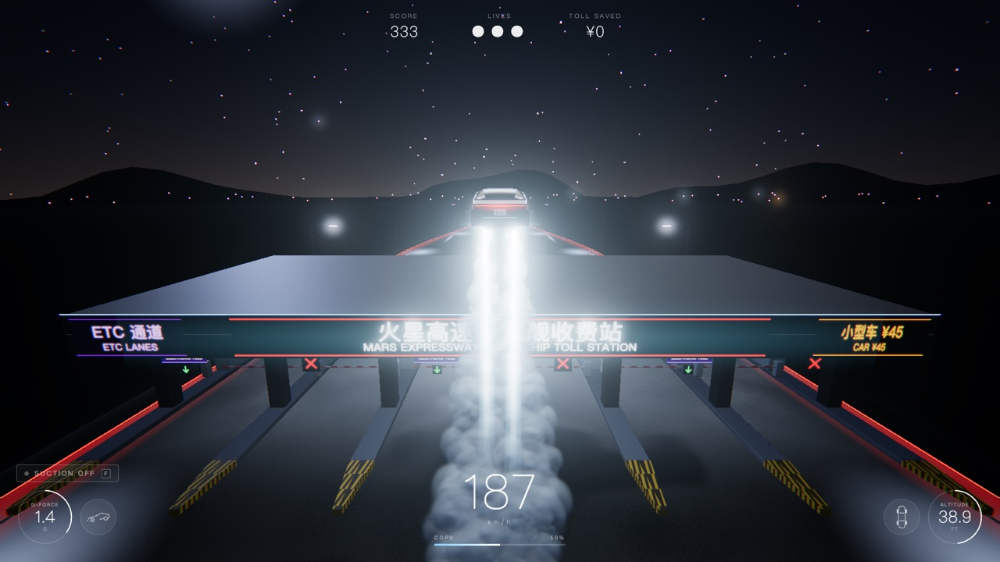
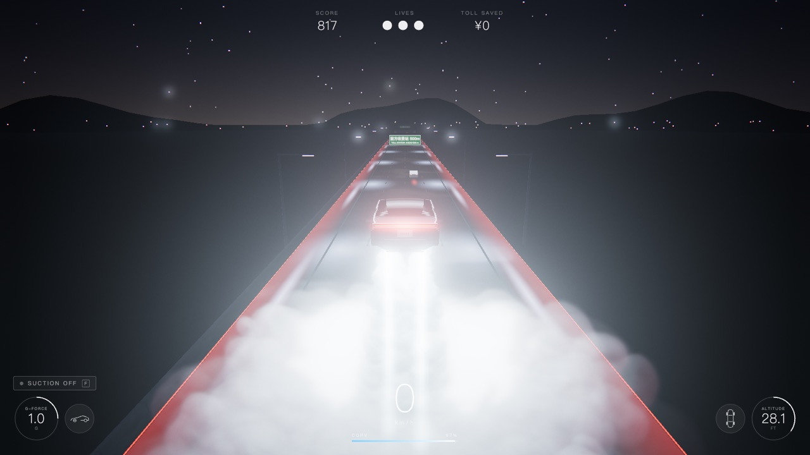
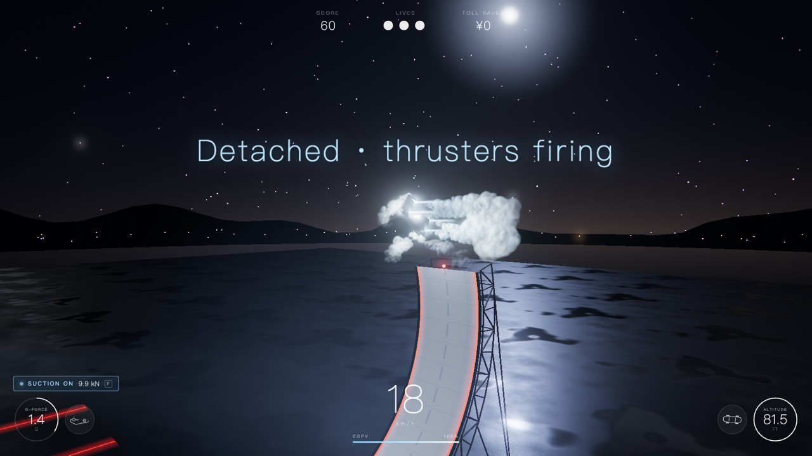

<p align="center">🌐 <b>English</b> · <a href="README.zh-CN.md">简体中文</a> · <a href="README.ja.md">日本語</a></p>

# RDSTR Toll Jump

**Fly the new Tesla Roadster over toll plazas on SpaceX cold-gas thrusters.** A 3D driving game that runs in your browser.

<p align="center">
  <a href="https://ryoshumei.github.io/toll-jump/?lang=en"><b>▶ Play now</b></a> · <a href="https://toll-jump.vercel.app/?lang=en">Mirror</a>
</p>



> Unofficial fan project. Not affiliated with or endorsed by Tesla or SpaceX.

## What you do

- **Fly.** Hold Space and four cold-gas jets under the car lift it off the road. Hold S while they fire and the car stops and hovers in place. Shift fires the rear boost jets.
- **Skip the toll.** Fly over the plaza roof or hop the boom, and you don't pay the toll (the classic skip-the-toll-booth meme). ETC lanes raise their booms for you: drive through one and you pay like everyone else. Ram the boom of a manual lane and you get fined.
- **Stunt arena.** Take the exit ramp to a separate venue with no traffic. Switch on the car's underbody suction (F) and drive up a curved wall that leans past vertical. Fly off the top upside down, and the thrusters flip the car upright and turn it around, so you land facing back the way you came.
- **Score.** Distance, airtime, barrel rolls, near misses, skipped tolls and stunts all score; ramming a boom costs points. You have three lives, and your best score is saved.

<p align="center">
  
  
</p>

## Controls

| Key | Action |
| --- | --- |
| W / ↑ | Accelerate |
| S / ↓ | Brake. In the air with the thrusters on, hold it to stop and hover in place |
| A D / ← → | Steer |
| Space (hold) | Thrusters: lift off and hover. They use the gas shown in the COPV bar, which refills on the ground. On the arena wall, Space detaches the car |
| Shift | Rear boost jets (up to about 380 km/h) |
| F | Suction on / off (the car's own underbody fans) |
| Q / E | Barrel roll in the air (finish it before you land) |
| C | Camera: chase / side / drone |
| L | Language: 中文 → English → 日本語 |
| Esc · M · R | Pause · mute · restart |

Press **Enter** or click to start. On phones and tablets the car drives itself up to about 160 km/h (BOOST goes faster), and on-screen buttons steer, brake, fire the thrusters and the boost, roll, and switch suction on and off. On the arena wall, with suction on, hold BRAKE to stop where you are, and let go to keep climbing.

## Languages

The game comes in Chinese, English and Japanese.

- On your first visit it follows your browser's language.
- To switch, press **L**, or click **中文 · EN · 日本語** at the top right of the start screen. The game remembers your choice.
- To open it in one language, use a link: [English](https://ryoshumei.github.io/toll-jump/?lang=en) · [简体中文](https://ryoshumei.github.io/toll-jump/?lang=zh) · [日本語](https://ryoshumei.github.io/toll-jump/?lang=ja)
- Road signs carry a Chinese line over an English one. With the Japanese UI they read Japanese over English, and money is shown in yen.

## Run it locally

Requires Node.js 22.12+ (or 20.19+).

```bash
npm install
npm run dev        # dev server at http://localhost:5173
npm run build      # type check + production build into dist/
npm run preview    # serve the build at http://localhost:4173
npm test           # unit tests (vitest)
```

## URL parameters

| Parameter | Effect |
| --- | --- |
| `?lang=zh\|en\|ja` | Language (also saved as your choice) |
| `?quality=low\|high` | Quality preset (pixel ratio cap, shadow map, particle count, MSAA) |
| `?debug` | fps, frame time, draw calls and triangles in the top left |
| `?car=glb\|procedural` | Force the Blender car or the built-in procedural car (default: the Blender car, or the procedural one if it fails to load) |
| `?autostart` | Skip the start screen |
| `?touch` | Touch mode on a desktop: on-screen buttons, and the car drives itself |

<details>
<summary><b>How it's made</b></summary>

- **Stack**: Vite, TypeScript (strict) and three.js. There is no physics engine: the arcade physics is our own code in `src/sim/`, plain logic with no three.js imports, covered by unit tests. The world, textures and audio are all generated in code.
- **Car**: modeled in Blender by a Python script (`tools/blender/build_roadster.py`) and exported to `public/models/roadster.glb`. If the file is missing or fails to load, the game uses a built-in procedural car. The node names it expects are in `docs/CAR_MODEL.md`, so you can drop in your own `roadster.glb`.
- **Thrusters and smoke**: nested additive plume cones, nozzle glare and an under-car light. The smoke is a single instanced draw call (about 2,500 depth-sorted particles) that rolls out into big clouds on the road. A landing burn fires by itself near the ground.
- **Rendering**: a spring-damped chase camera; HDR post-processing with bloom, vignette, grain, chromatic aberration that grows with speed, and ACES tone mapping; and an adaptive pixel ratio. All shaders compile on the loading screen, so nothing compiles mid-game.
- **Audio**: synthesized live with WebAudio (motor whine, thruster roar, wind, suction fans, impacts, the ETC beep).
- **Text**: every UI string lives in one dictionary, `src/ui/i18n.ts`, and a test checks that each language has every key. Signs are canvas textures, redrawn the moment the language changes.

</details>

<details>
<summary><b>Performance</b></summary>

Measured with Playwright and the Chromium headless shell on the real GPU (`--use-angle=metal`, Apple M4, 1600×900, production build, `tools/perf.mjs`):

| Scene | Pixel ratio | Avg frame | p95 | fps |
| --- | --- | --- | --- | --- |
| Driving through traffic (150–320 km/h) | 1.0 | 16.67 ms | 16.8 ms | 60 |
| Hovering in thick smoke (about 1,100 particles) | 1.0 | 16.67 ms | 16.8 ms | 60 |
| Driving | 1.5 | 16.67 ms | 16.8 ms | 60 |

Without the 60 Hz cap on an idle machine, a frame takes 2.95 ms on average while driving and 7.26 ms while hovering in thick smoke. With Blender busy in the background, the adaptive pixel ratio stepped down from 1.5 to 1.25 and held 60 fps.

What keeps it smooth: `renderer.setAnimationLoop`, a clamped physics step (dt ≤ 1/30), no allocations in the frame loop, instanced or merged geometry (about 150 draw calls), the shader warm-up, and a single shadow-casting light (the moonlight that follows the car).

</details>

<details>
<summary><b>Project layout</b></summary>

```text
src/main.ts     game loop, state machine, scene switches (highway / arena), debug hooks
src/config.ts   every tunable number
src/sim/        pure game logic with unit tests: vehicle, suction, wall, toll, collision, score, course
src/render/     car, thrusters, smoke, road, toll plaza, exit ramp, arena, traffic, post-processing, camera
src/ui/         HUD, screens, audio, input, i18n
tools/          Playwright scripts (screenshots, performance, smoke and phone checks) and the Blender car script
docs/           SPEC.md (game spec), CAR_MODEL.md (GLB contract), img/ (README screenshots)
```

</details>

<details>
<summary><b>Tests</b></summary>

- `npm test` runs the unit tests: thrust, gravity and gas, hover braking, barrel rolls, suction, the arena wall (sticking, falling off, the launch from the top, the flip and the reversed landing), every toll outcome, collisions and near misses, scoring, the course layout, traffic rules, input (keys held through a restart, the touch pedals and cruise speed), camera framing on an upright phone, and the i18n dictionary.
- `node tools/smoke-test.mjs` (after `npm run preview`) plays the main beats with real key presses (debug teleports set each one up): driving, thrusters, an ETC lane, a plaza flyover, switching languages, the stunt from the top of the wall, and the way back to the highway.
- `node tools/restart-check.mjs` restarts with keys held, from the pause screen and from the arena wall, and checks that each restart is a fresh start.
- `node tools/touch-check.mjs` (with `npm run preview` running) plays as a phone at 390×844, 844×300 and 844×390. At each size it checks that no button or gauge overlaps another or the car. It also checks that the prompts say tap, walks the start, pause and game-over screens with real taps, stops the car on the wall, and confirms the picture never stretches.
- `npm run shots` (after `npm run preview`) writes the full screenshot set to `shots/` (not committed). `SHOT_LANG=en` or `ja` shoots it in that language.

</details>

## License

[MIT](LICENSE). Tesla and SpaceX are trademarks of their respective owners; this license grants no rights to them.
