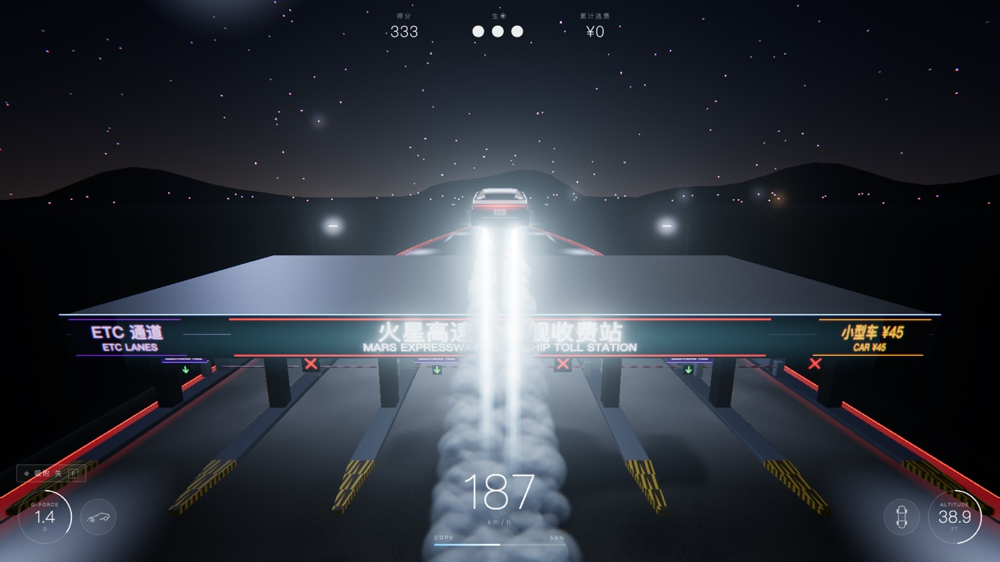
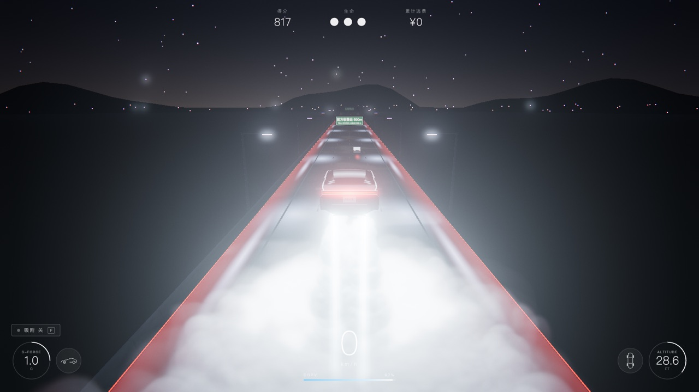
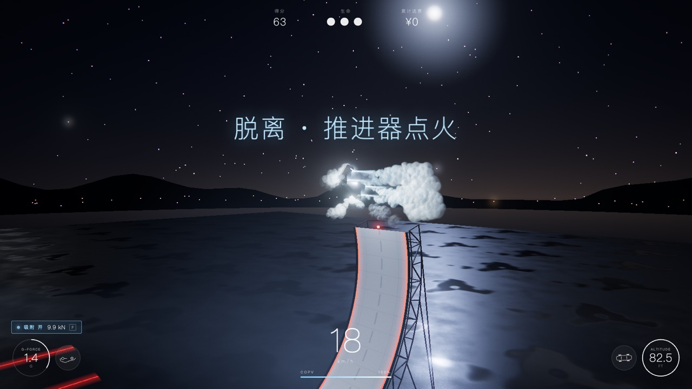

<p align="center">🌐 <a href="README.md">English</a> · <b>简体中文</b> · <a href="README.ja.md">日本語</a></p>

# 飞跃收费站 · RDSTR Toll Jump

**开着新款 Tesla Roadster，用 SpaceX 冷气推进器飞过收费站。** 一个打开浏览器就能玩的 3D 驾驶游戏。

<p align="center">
  <a href="https://ryoshumei.github.io/toll-jump/?lang=zh"><b>▶ 立即试玩</b></a> · <a href="https://toll-jump.vercel.app/?lang=zh">海外备用地址</a>
</p>
<p align="center"><sub>github.io 在中国大陆一般可以直接打开；海外备用地址在大陆通常打不开。</sub></p>



> 非官方粉丝作品，与 Tesla、SpaceX 无关，也未获得其认可。

## 玩法

- **飞起来**：按住空格，车底 4 个冷气喷口向下喷气，把车托离路面；喷气时按住 S，车会在空中定点悬停；按 Shift 从车尾喷气加速。
- **逃过路费**：从收费站雨棚顶上飞过去，或者从收费杆上跳过去，过路费就省下了（网上那个「飞过收费站」的梗）。ETC 车道会自动抬杆，正常开过去照常扣费；硬闯人工车道的栏杆（冲卡）会被罚款。
- **特技场**：从高速匝道开进一个没有车流的独立场地。按 F 打开车底吸附，沿着越过垂直、顶部向后仰的弧形墙开上去，从墙顶倒着飞出；推进器把车翻正并掉头，落地时车头与来时方向相反。
- **计分**：行驶距离、滞空时间、桶滚、擦肩、逃费、特技都能加分，冲卡会扣分。共 3 条命，最高分会保存下来。

<p align="center">
  
  
</p>

## 操作

| 按键 | 动作 |
| --- | --- |
| W / ↑ | 加速 |
| S / ↓ | 刹车；在空中开着推进器时按住 = 停住并定点悬停 |
| A D / ← → | 转向 |
| 空格（按住） | 冷气推进：升空、悬停。消耗 COPV 气瓶里的气，落地后回充；在特技场的墙上按空格 = 脱离 |
| Shift | 后向喷气加速（最高约 380 km/h） |
| F | 吸附 开 / 关（车自带的车底风扇系统） |
| Q / E | 空中桶滚（落地前必须转完） |
| C | 镜头：追尾 / 侧拍 / 无人机 |
| L | 切换语言：中文 → English → 日本語 |
| Esc · M · R | 暂停 · 静音 · 重新开始 |

按 **Enter** 或点击画面开始。在手机和平板上，车会自动前进，用屏幕按钮转向、刹车、推进、加速喷气、桶滚和开关吸附；在特技场的墙上，开着吸附时按住「刹」就停在原地，松开继续往上爬。

## 语言

游戏支持中文、英文和日文。

- 第一次打开时跟随浏览器语言。
- 按 **L**，或点开始画面右上角的 **中文 · EN · 日本語** 切换，游戏会记住你的选择。
- 也可以用链接直接打开指定语言：[简体中文](https://ryoshumei.github.io/toll-jump/?lang=zh) · [English](https://ryoshumei.github.io/toll-jump/?lang=en) · [日本語](https://ryoshumei.github.io/toll-jump/?lang=ja)
- 路牌上面一行中文、下面一行英文；选日语时，上面一行换成日文，过路费也按日元显示。

## 本地运行

需要 Node.js 22.12 以上（或 20.19 以上）。

```bash
npm install
npm run dev        # 开发服务器 http://localhost:5173
npm run build      # 类型检查 + 生产构建（输出到 dist/）
npm run preview    # 预览构建结果 http://localhost:4173
npm test           # 单元测试（vitest）
```

## URL 参数

| 参数 | 作用 |
| --- | --- |
| `?lang=zh\|en\|ja` | 指定语言（同时保存为你的选择） |
| `?quality=low\|high` | 画质预设（像素比上限、阴影贴图、粒子数、MSAA） |
| `?debug` | 左上角显示 fps、帧耗时、draw call 数、三角形数 |
| `?car=glb\|procedural` | 强制使用 Blender 车模或内置的程序化车模（默认：优先用 Blender 车模，加载失败时用程序化车模） |
| `?autostart` | 跳过开始画面 |
| `?touch` | 在电脑上也启用触屏模式（显示触屏按钮，车自动前进） |

<details>
<summary><b>怎么做的</b></summary>

- **技术栈**：Vite + TypeScript（strict）+ three.js。没有用物理引擎，街机物理都是自己写的，在 `src/sim/`：纯逻辑、不引用 three.js、有单元测试。世界、贴图、音频全部用代码生成。
- **车模**：用 Python 脚本（`tools/blender/build_roadster.py`）在 Blender 里建模，导出为 `public/models/roadster.glb`。文件不存在或加载失败时，自动换成内置的程序化车模。节点命名约定见 `docs/CAR_MODEL.md`，按约定放进你自己的 `roadster.glb` 就能替换。
- **推进器与烟雾**：多层加性混合的羽流锥体、喷口眩光、车底灯光。烟雾只用一次实例化绘制（约 2500 个按深度排序的粒子），打到路面后翻滚扩散成大团云。接近地面时会自动点火做落地缓冲。
- **渲染**：弹簧阻尼追尾镜头；HDR 后期（泛光、暗角、颗粒、随速度增强的色差、ACES 色调映射）；自适应像素比。所有着色器在加载画面就编译好，游戏中途不会因为编译而卡顿。
- **音频**：WebAudio 实时合成（电机啸叫、推进器轰鸣、风声、吸附风扇、撞击、ETC「嘀」声）。
- **文字**：界面文字全部放在一个字典 `src/ui/i18n.ts` 里，测试会检查每种语言的键都齐全。路牌是 canvas 贴图，切换语言时立即重画。

</details>

<details>
<summary><b>性能</b></summary>

用 Playwright 驱动 Chromium headless shell，走真实 GPU（`--use-angle=metal`，Apple M4，1600×900，生产构建，`tools/perf.mjs`）：

| 场景 | 像素比 | 平均帧耗时 | p95 | fps |
| --- | --- | --- | --- | --- |
| 在车流中行驶（150–320 km/h） | 1.0 | 16.67 ms | 16.8 ms | 60 |
| 在浓烟中悬停（约 1100 粒子） | 1.0 | 16.67 ms | 16.8 ms | 60 |
| 行驶 | 1.5 | 16.67 ms | 16.8 ms | 60 |

解除 60 Hz 上限、机器空闲时，行驶平均每帧 2.95 ms，浓烟中悬停平均 7.26 ms。后台跑着 Blender 时，自适应像素比从 1.5 降到 1.25，保持 60 fps。

流畅的原因：`renderer.setAnimationLoop`、物理步长钳制（dt ≤ 1/30）、帧循环内不分配内存、重复物体用实例化或合并几何（约 150 个 draw call）、着色器预热，以及只有一个投射实时阴影的光源（跟着车走的月光）。

</details>

<details>
<summary><b>目录结构</b></summary>

```text
src/main.ts     游戏循环、状态机、场景切换（高速 / 特技场）、调试接口
src/config.ts   全部可调参数
src/sim/        纯游戏逻辑，有单元测试：车辆、吸附、墙、收费站、碰撞、计分、赛道
src/render/     车、推进器、烟雾、道路、收费站、匝道、特技场、车流、后期、镜头
src/ui/         HUD、各个画面、音频、输入、多语言
tools/          Playwright 脚本（截图、性能、冒烟测试）和 Blender 车模脚本
docs/           SPEC.md（游戏规格）、CAR_MODEL.md（GLB 约定）、img/（README 截图）
```

</details>

<details>
<summary><b>测试</b></summary>

- `npm test` 运行单元测试：推进、重力与气瓶、悬停刹车、桶滚、吸附、特技场的墙（贴墙、掉落、从墙顶飞出、翻转、反向落地）、收费站的各种判定、碰撞与擦肩、计分、赛道布局、交通规则、输入（重新开始时还按着的键、触屏的油门与刹车），以及多语言字典。
- `node tools/smoke-test.mjs`（先运行 `npm run preview`）用真实按键把主要环节各玩一遍（每个环节先用调试接口传送到位）：行驶、推进、走 ETC、飞越收费站、切换语言、从墙顶开始的特技、回到高速。
- `node tools/restart-check.mjs` 分别在按着键时、从暂停画面、在特技墙上重新开始，检查每次都和全新开局一样。
- `npm run shots`（先运行 `npm run preview`）把全套截图生成到 `shots/`（不放进仓库）；加上 `SHOT_LANG=en` 或 `ja` 就用该语言拍。

</details>
